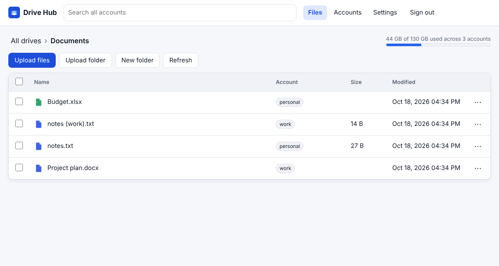
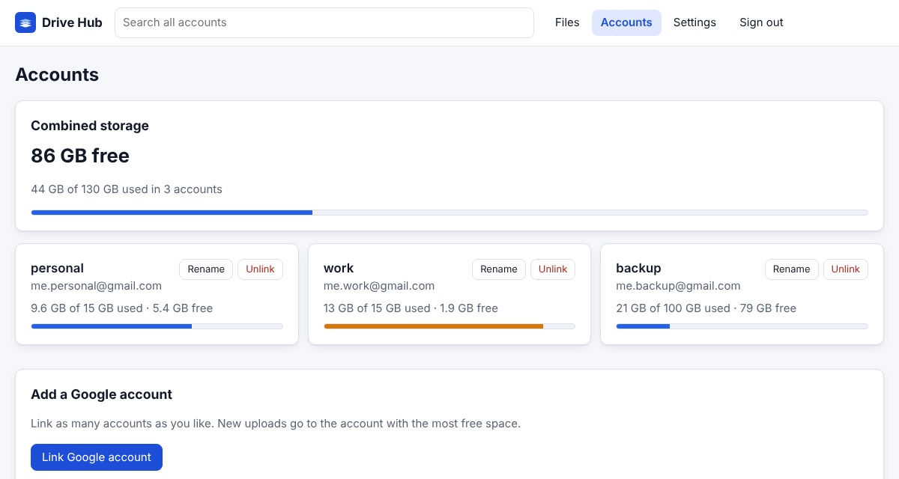
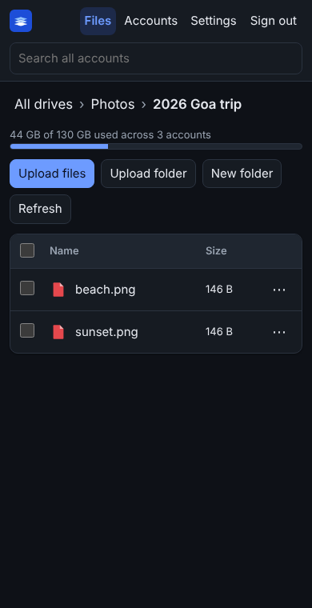

# Drive Hub

**Join any number of Google Drive accounts into one drive you host yourself.** Browse, search and upload across all of them from a web app on any device, or mount everything as a single network drive on Windows, macOS and Linux.

Five free Google accounts give you 75 GB in one place. New uploads automatically go to the account with the most free space.



## Features

- **One unified tree.** A folder that exists in several accounts (for example `Photos` in two of them) shows up as one merged folder. Each file has a badge showing which account stores it.
- **Pooled storage.** You see one combined quota. Each upload goes to the account with the most free space, and any folders it needs are created there automatically.
- **Search everything at once.** One search box queries every linked account in parallel.
- **Full file management:**
  - upload files or whole folders (drag and drop works)
  - download, and preview images, video, audio, PDF and text
  - rename, move, copy, and delete (deleted items go to the Drive trash)
  - get a share link
  - move a file to a different account to free up space
- **Mount it as a drive (WebDAV).** Works with Windows "Map network drive", macOS Finder, Linux file managers, rclone and mobile WebDAV apps. It passes 100% of the [litmus](https://notroj.github.io/litmus/) WebDAV compliance suite, including locking and properties.
- **Installable web app.** Responsive on phones, light and dark themes, and you can add it to your home screen.
- **Private by design.** You run your own server, so your Google sign-ins never touch anyone else's. Saved tokens are encrypted, and login supports 2FA (TOTP). WebDAV uses separate app passwords that you can revoke.
- **Simple to run.** One Docker container, with all data in a single SQLite file.

| Accounts and combined storage | Phone, dark mode |
|---|---|
|  |  |

## Try it in 30 seconds (no Google setup)

```bash
pip install git+https://github.com/Ethos6/free-drive-hub
drivehub demo
```

Open http://localhost:8080 and sign in with `demo-password`. The demo has three sample accounts kept in memory, and nothing is saved.

## Set up with your Google accounts

### 1. Create a Google OAuth client (one time, about 5 minutes)

Google only lets apps access Drive through an OAuth client. You create your own, so no third party is involved.

1. Open [Google Cloud Console](https://console.cloud.google.com/) and create a project, for example "Drive Hub".
2. Go to **APIs & Services → Library**, search for **Google Drive API** and click **Enable**.
3. Open **Google Auth Platform** (also called **OAuth consent screen**):
   - **Branding:** set the app name to "Drive Hub" and enter your email.
   - **Audience:** choose **External**. Then click **Publish app** so the status becomes **In production**.
     > Why publish? In "Testing" status, Google expires the saved sign-in after 7 days and you would have to link every account again. A published but unverified app is fine for personal use. Google shows an "unverified app" warning when you link an account; click **Advanced → Go to Drive Hub**. Unverified apps are limited to 100 users, which doesn't matter for personal use.
   - **Data access:** add the scope `https://www.googleapis.com/auth/drive`.
4. Go to **Clients → Create client**:
   - **Application type:** Web application
   - **Authorized redirect URI:** `<your address>/oauth/google/callback`, for example `http://localhost:8080/oauth/google/callback`, or `https://drive.example.com/oauth/google/callback` for remote access.
5. Copy the **Client ID** and **Client secret**.

### 2. Run the server

```bash
git clone https://github.com/Ethos6/free-drive-hub && cd free-drive-hub
cp .env.example .env        # paste GOOGLE_CLIENT_ID and GOOGLE_CLIENT_SECRET, set DRIVEHUB_BASE_URL
docker compose up -d --build
docker logs drivehub        # shows a one-time setup code
```

Without Docker:

```bash
pip install .
drivehub serve --port 8080
```

### 3. First sign-in

Open your address, enter the **setup code** from the log, and choose a password. Then go to **Accounts → Link Google account** and repeat for each account. Use a different Google account each time; the account picker appears automatically.

Turn on **Settings → Two-factor sign-in** if the server is reachable from the internet.

## Use it from anywhere

The server has to be reachable from your devices. Pick one option:

| Option | Good for | How |
|---|---|---|
| **Tailscale** | Private access from your own devices only, with no open ports | Install Tailscale on the server and your devices, run `tailscale serve --bg 8080`, and use the `https://<machine>.<tailnet>.ts.net` address it gives you as `DRIVEHUB_BASE_URL` |
| **Cloudflare Tunnel** | A public HTTPS address without opening ports | Create a *named* tunnel on your own domain that points to `http://localhost:8080`. Quick tunnels get a new address each time, which breaks the Google redirect URI |
| **Reverse proxy** | A VPS or home server with a domain | Caddy example below: it gets certificates automatically |

```caddyfile
drive.example.com {
    reverse_proxy localhost:8080
}
```

When you use a proxy or tunnel, set `DRIVEHUB_BASE_URL=https://drive.example.com` and `DRIVEHUB_TRUST_PROXY=1`, and add the matching redirect URI to your Google OAuth client. **Use HTTPS for anything beyond localhost.** Google requires it for redirect URIs, and Windows only accepts WebDAV passwords over HTTPS.

## Mount it as a drive

Create an app password under **Settings → App passwords**. Then connect to `<your address>/dav/` with any user name and that app password.

- **Windows:** File Explorer → This PC → *Map network drive* → `https://drive.example.com/dav/`
- **macOS:** Finder → Go → *Connect to Server* → `https://drive.example.com/dav/`
- **Linux:** in Files/Nautilus or Dolphin, open `davs://drive.example.com/dav/`
- **rclone:** `rclone config create hub webdav url=https://drive.example.com/dav vendor=other user=me pass=$(rclone obscure APP_PASSWORD)`. `rclone about hub:` then shows your combined free space.
- **Phones:** any WebDAV file manager, or add the web app to your home screen

## How it works

```
 browser / WebDAV client ──HTTPS──► Drive Hub (your server) ──Drive API──► Google account 1
                                    · merged folder index                ├► Google account 2
                                    · pooled upload placement            └► Google account N
                                    · SQLite: settings, encrypted tokens
```

- **Folder map.** Each account's folder tree is loaded once and cached for 5 minutes, so opening a path doesn't need a call per folder. Listings are cached for 15 seconds. **Refresh** clears both caches.
- **Name clashes.** When two files would show with the same name in a merged folder, the later one gets its account label added, for example `notes (work).txt`.
- **Google Docs, Sheets and Slides** are downloaded as `.docx`, `.xlsx` and `.pptx`. "Open in Google Drive" opens the original.
- **Moves keep files in their account.** Moving or renaming a file never transfers it between accounts. Use **Move to another account** to transfer one.
- **Reliable uploads.** Files upload with Google's resumable protocol in 8 MB chunks. Rate limits and server errors are retried with exponential backoff.
- **Account errors.** If one account fails (for example, you revoked access), its files are hidden and a banner explains why. The other accounts keep working.

## Security notes

- Google refresh tokens are encrypted at rest (Fernet) with `DRIVEHUB_SECRET_KEY`, or with a random key stored in `data/secret.key`. **Back up the whole `data/` folder:** the database is useless without the key.
- **Passwords:** hashed with scrypt.
- **Login protection:** failed logins are rate limited per IP (10 per 15 minutes).
- **Sessions:** HttpOnly, SameSite=Lax cookies. State-changing API calls also need a custom header, which blocks cross-site requests.
- **Browser hardening:** a strict Content-Security-Policy. Downloads are sandboxed, and HTML and SVG files are never rendered inline.
- **Google access:** Drive Hub requests the full `drive` scope because it has to read and organise files it didn't create. Only your server talks to Google.
- **Unlinking** an account deletes its token from Drive Hub. To revoke access at Google too, visit [myaccount.google.com/permissions](https://myaccount.google.com/permissions).

## Limits

- Only each account's **My Drive** is included. Shared drives, "Shared with me" and shortcuts are left out.
- Files pass through your server on upload and download, so your server's bandwidth is the limit.
- Google's API quotas apply. Very large libraries load more slowly the first time, while the folder map is built.
- It is a single-user app: one password, one person's accounts.

## Development

```bash
pip install -e ".[dev]"
pytest                    # unit, API, WebDAV and Google-client tests (no network needed)
python scripts/litmus_server.py 8099 & litmus http://127.0.0.1:8099/dav/ test litmus-app-password
```

The Google client is tested against a fake Drive API (`httpx.MockTransport`), covering paging, retries, token refresh, resumable uploads and resume after failure. `drivehub/backends/memory.py` is an in-memory drive used by the tests and the demo. Adding another provider means implementing the same small `Backend` interface.

## License

MIT
